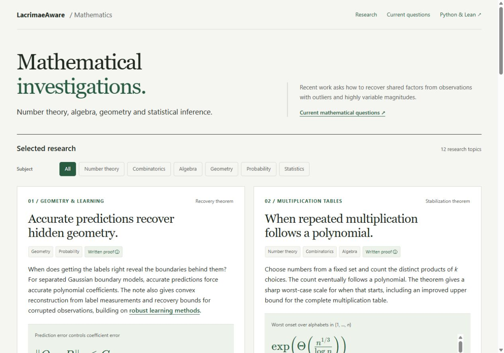

# Mathematical research

Independent undergraduate work in number theory, algebra, geometry and statistical inference, developed with AI assistance.

**[Explore the portfolio →](https://lacrimaeaware.github.io/mathematical-research/)** · [Research index](RESEARCH.md) · [Workflow case study](site/summaries/research-workflow.md)

[](https://lacrimaeaware.github.io/mathematical-research/)

## Three starting points

| Project | What to explore |
|---|---|
| [Geometry recovery](site/summaries/geometry-recovery.md) | How can hidden decision boundaries be recovered from labels, including corrupted observations? |
| [Multiplication-table stabilization](site/summaries/multiplication-tables.md) | When does the number of distinct products follow a polynomial, and how long can that take? |
| [Research workflow and current directions](site/summaries/research-workflow.md) | Robust factor recovery, literature comparisons, bounded tests and supporting tools. |

## Current direction

Recent work asks how to recover shared factors and unequal background noise from observations with outliers and highly variable magnitudes. The [workflow page](site/summaries/research-workflow.md) describes the research cycle and the [public tool examples](site/workflow/README.md).

**[Browse all twelve research topics →](https://lacrimaeaware.github.io/mathematical-research/#research)** Each page explains the question, result, source connection and proof scope. Further topics include symmetric networks, hidden stages, factorization obstructions and arithmetic tensors. The prime-pattern page compares the original formalized construction with the larger bound from a Rankin-style adaptation.

## Run the presentation

```sh
npm ci
npm run build
npm run preview
```

The build checks card/metadata agreement and renders the mathematics with KaTeX. [Build details](DEVELOPMENT.md) · [Python, Lean and proof labels](site/summaries/methods.md)

---

**LacrimaeAware** · Mathematical research.
